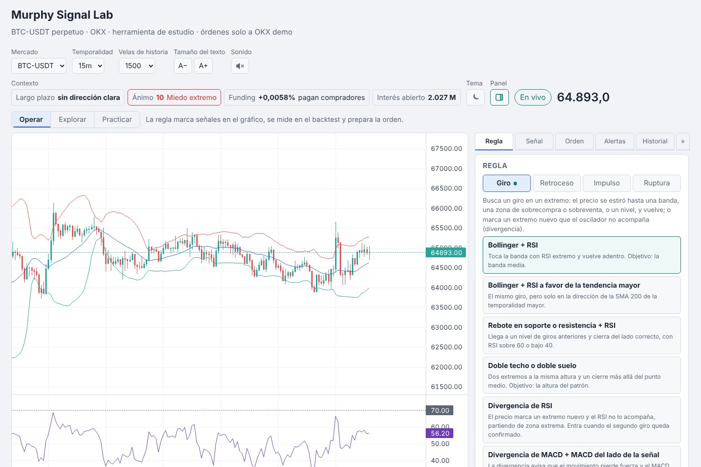
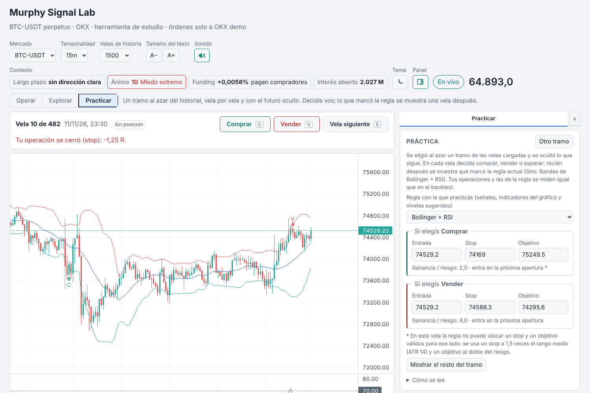

# Murphy Signal Lab

Herramienta de estudio para practicar análisis técnico con los indicadores de John J. Murphy
(*Technical Analysis of the Financial Markets*, 1999) sobre los perpetuos BTC-USDT y ETH-USDT de OKX.
Corre entera en el navegador: no tiene servidor propio ni cuentas.



**Manual de uso con capturas: [docs/manual-de-uso.pdf](docs/manual-de-uso.pdf).** Es el mejor lugar para
empezar si querés ver cómo se usa antes de instalar nada.

## Qué hace

- **Arma una regla con bloques.** Bollinger, RSI, estocástico, MACD, medias móviles, soporte y resistencia,
  líneas de tendencia, Fibonacci, divergencias, dobles techos y pisos, volumen y OBV. Hay 18 combinaciones
  listas, y cada bloque cita las páginas de Murphy en las que se apoya.
- **Marca las señales en el gráfico en vivo** y explica cada una: qué condiciones se cumplieron, con qué
  valores, y dónde quedan el stop y el objetivo.
- **Mide la regla sobre velas pasadas (backtest)**, con comisiones y funding, en múltiplos del riesgo (R):
  curva de resultados, en qué condiciones funciona mejor y cuánto depende de cada parámetro.
- **Modo Practicar.** Oculta el futuro de un tramo al azar y te deja operar vela por vela, para comparar tus
  decisiones con las de la regla.
- **Calcula la orden**: tamaño según el riesgo, margen y relación beneficio/riesgo después de comisiones.
- **Opcional: envía la orden a OKX Demo trading**, con dos clics y nunca de forma automática.



## Qué no hace

- No opera con dinero real. Cada pedido a OKX lleva la marca de simulación y la herramienta rechaza las
  claves de la cuenta real; no hay opción para cambiarlo.
- No opera sola. Una señal nunca envía una orden: la confirmás vos.
- No promete resultados. En las pruebas hechas con datos reales, ninguna de las combinaciones mostró una
  ventaja comprobada después de comisiones. Sirve para estudiar y practicar, no como recomendación de inversión.

## Cómo ejecutarlo

Necesitás [Node.js](https://nodejs.org) 20 o superior y una terminal.

```bash
git clone https://github.com/Jorgelina1983/MurphysLab.git
cd MurphysLab
npm install        # solo la primera vez
npm run dev
```

Abrí en el navegador la dirección que muestra la terminal: <http://localhost:5173>. Para cerrarlo, Ctrl+C en
la terminal.

El mercado y la temporalidad se eligen en pantalla y quedan en la dirección, así que cada combinación tiene
su enlace: `http://localhost:5173/?symbol=ETH&tf=15m` abre ETH en 15 minutos.

Otros comandos:

```bash
npm test           # pruebas unitarias (Vitest)
npm run typecheck  # verificación de tipos
npm run build      # compilación de producción en dist/
npm run preview    # sirve dist/ para probar la compilación
```

## Primeros pasos

1. **Elegí una regla** en la pestaña Regla: una combinación lista, o prendé y apagá bloques.
2. **Mirá las señales** en el gráfico. Un clic en una flecha abre su explicación en la pestaña Señal.
3. **Leé el backtest** debajo del gráfico antes de confiar en la regla: cuántas operaciones, cuánto ganó o
   perdió en R y cómo le fue en el tramo final, que no se usó para elegirla.
4. **Practicá** en el modo Practicar, con el futuro oculto.
5. **Prepará la orden** en la pestaña Orden. Para enviarla a OKX demo seguí la sección siguiente.

El manual desarrolla cada paso con capturas.

## Enviar órdenes a OKX Demo trading (opcional)

La herramienta funciona completa sin conectar ninguna cuenta. Si querés enviar las órdenes de práctica:

1. En OKX, entrá al modo **Demo trading** y creá ahí una clave de API con permiso de trading y sin retiro.
2. Pegá la clave, el secreto y la frase en la pestaña Orden y conectá.
3. Revisá la orden, hacé clic en enviar y después en confirmar.

La clave se guarda en tu navegador sin cifrar y no se envía a ningún otro lugar que OKX. Usá solo claves de
demo.

Dos cosas a tener en cuenta:

- **OKX demo tiene su propio libro de órdenes y su propio precio.** Normalmente sigue al mercado real a pocos
  dólares, pero en movimientos bruscos puede alejarse más de 1 %. El gráfico y las señales usan el mercado
  real, así que la pestaña Orden avisa cuando los dos precios no coinciden.
- **La lectura de resultados desde OKX demo** (en Historial) se probó con respuestas simuladas y todavía poco
  con cuentas reales de demo.

## Publicarlo en un servidor

Es un sitio estático: el servidor solo entrega archivos. Los datos, la configuración, el historial y las
claves de OKX demo de cada persona quedan en su propio navegador y no pasan por el servidor.

1. Apuntá el subdominio al servidor con un registro A (`murphyslab.namilabs.ai` → IP del droplet).
2. Configurá el servidor web con uno de los ejemplos de `deploy/`: `Caddyfile.example` o
   `nginx.example.conf`. Los dos sirven el sitio por HTTPS y piden una contraseña compartida.
   HTTPS es obligatorio: el navegador solo firma los pedidos a OKX demo en HTTPS o en localhost.
3. Publicá con `DEPLOY_HOST=usuario@servidor ./deploy/deploy.sh`. Corre las pruebas, arma el sitio
   y copia solo `dist/`. La carpeta `book/` no forma parte del sitio.

Quien lo use para enviar órdenes necesita su propia clave de API de OKX **Demo trading**.

## Mercado y temporalidad en la dirección

El mercado y la temporalidad se leen de la dirección de la página, así cada
combinación tiene su propio enlace:

- `http://localhost:5173/?symbol=BTC&tf=5m`
- `http://localhost:5173/?symbol=ETH&tf=15m`

Los selectores de la barra superior actualizan la dirección. Para recibir
alertas de BTC y de ETH a la vez, abrí cada enlace en una pestaña distinta:
cada pestaña vigila un solo mercado.

Para agregar otro mercado, sumá una línea a `SYMBOLS` en `src/feed/okx.ts`.

El sonido de las alertas se prende y se apaga con el ícono del parlante, arriba
a la derecha (verde = activado). Los navegadores bloquean el audio hasta que hay
una interacción con la página: después de recargar, el sonido vuelve con el
primer clic en cualquier lugar.

## Qué hay en pantalla

A la izquierda están el gráfico, el backtest y la comparación de temporalidades.
El botón **Panel** de arriba (o el » de las pestañas) esconde la columna derecha
y deja el gráfico a todo el ancho; elegir una señal la vuelve a mostrar.
A la derecha, en el modo Operar, las pestañas en el orden del trabajo: **Regla** (combinaciones,
bloques, stop y objetivo), **Señal** (por qué se disparó y las condiciones de la
vela bajo el cursor), **Orden** (niveles, cantidad, veredicto de riesgo y el
texto para cargar en OKX demo) y **Alertas**. Un punto naranja en *Señal* avisa
que hay una señal nueva. Los bloques activos muestran un resumen en una línea y
se abren con un clic; las notas largas están plegadas bajo "Cómo se lee".

- **Gráfico**: velas, una flecha en cada señal (V = venta, C = compra) y los
  indicadores de los bloques activos: bandas y medias sobre el precio, RSI y
  MACD en paneles debajo. El horario es UTC.
- **Regla**: se elige una combinación ya armada, ordenada por lo que busca:
  *Giro* (Bollinger + RSI, rebote en un nivel), *Retroceso* (Fibonacci),
  *Impulso* (cruce de MACD o de medias) y *Ruptura* (cierre que atraviesa un
  nivel). Cada combinación tiene un solo disparador y confirmaciones del mismo
  tipo, porque mezclar tipos casi siempre deja la regla sin señales. Después
  se ajustan sus parámetros, el filtro de tendencia, el stop y el objetivo, y
  se puede guardar con un nombre (queda en este navegador).
- **Explorar** (pestaña): cualquier indicador, con sus propios parámetros,
  dibujado en el gráfico para analizar. Mientras está abierta el gráfico no
  muestra señales ni niveles de orden; la regla no cambia y las alertas
  siguen sonando. En lugar del backtest aparece un análisis de los
  indicadores marcados: si se refuerzan, si coinciden pocas veces o si se
  contradicen, par por par, con cuántas velas cumple cada uno y todos juntos.
- **Volumen y liquidaciones** (casillas bajo el gráfico): el volumen se dibuja
  bajo las velas. Las liquidaciones son las ya ejecutadas en OKX para ese
  mercado: un panel con los USDT liquidados por vela (largos hacia abajo,
  cortos hacia arriba) y tres líneas violetas en las franjas de precio donde
  más se liquidó. OKX solo guarda los últimos días y la carga llega hasta
  4.000 órdenes, así que en temporalidades largas cubre solo las últimas
  velas. No es un mapa de liquidaciones futuras.
- **Tema** (arriba): botón para pasar del tema oscuro al claro; se recuerda.
- **Miedo y codicia** (arriba): el Crypto Fear & Greed Index de alternative.me,
  de 0 a 100, una vez por día. Es contexto de sentimiento del mercado cripto;
  no es un indicador de Murphy y ninguna regla lo usa.
- **Soporte y resistencia**: niveles tomados de máximos y mínimos de reacción
  (un extremo que ninguna de las N velas de cada lado supera), dibujados como
  líneas punteadas. Un nivel recién se usa N velas después de formarse, y un
  nivel roto cambia de rol. Se dibujan hasta tres por lado; los probados más
  de una vez llevan su cuenta (×2, ×3), y la regla puede exigir un mínimo de
  pruebas.
- **Retrocesos de Fibonacci**: 38,2%, 50% y 61,8% del último tramo entre dos
  giros confirmados. Después de una suba sirven de soporte; después de una
  baja, de resistencia (Murphy, pp. 334–338).
- **Stop y objetivo**: el stop puede ser el extremo de las dos últimas velas,
  el máximo o mínimo de N velas, o un múltiplo del rango medio (ATR). El
  objetivo, la banda media de Bollinger, un múltiplo del riesgo, el próximo
  soporte o resistencia, o el extremo del tramo de Fibonacci.
- **Cuando una regla no da señales**: el backtest se recalcula con cada
  cambio y muestra cuántas velas cumple cada bloque por separado y cuántas
  todos a la vez.
- **Por qué se disparó**: para la última señal, o la que elijas en la lista
  del backtest o en las alertas, un texto con cada condición cumplida y sus
  valores, el stop y el objetivo con su motivo, y las páginas de Murphy. Se
  puede copiar.
- **Orden** (pestaña): niveles, cantidad y veredicto de riesgo. La cantidad
  sale del riesgo elegido (1% del capital por defecto) y nunca supera el 15%
  de margen por mercado.
- **Enviar a OKX demo**: con una clave de API creada en el modo Demo trading
  de OKX, el botón envía la orden de la pantalla con su TP y SL, después de
  una confirmación. Solo opera en demo: cada pedido lleva la marca de
  simulación (`x-simulated-trading: 1`), que es fija en el código, y OKX
  rechaza con ella las claves de la cuenta real. Las claves quedan guardadas
  en este navegador, en texto plano: usá solo claves de demo. Nada se envía
  solo al dispararse una señal.
- **Historial** (pestaña): cada orden que llega a OKX demo, aceptada o
  rechazada, queda registrada con sus niveles, cantidad, números de riesgo,
  la regla y la explicación de la señal. Se le pueden agregar notas, y
  "Exportar texto" baja un archivo Markdown para pegar en un informe. También
  se puede registrar una orden cargada a mano. Se guarda solo en este
  navegador; no sabe cómo terminó la operación.
- **Órdenes anticipadas**: con reglas de soporte, resistencia o Fibonacci, la
  pestaña Orden ofrece una orden límite en el nivel vigente, con stop a 1,5
  ATR y objetivo según la regla, para dejarla cargada antes de la señal.
- **Condiciones**: cada condición de la regla con ✓ o ✗ para la última vela
  cerrada, o para la vela sobre la que esté el cursor.
- **¿Vale la pena el riesgo?**: para una entrada, un stop y un objetivo,
  calcula el resultado neto de comisiones y da un veredicto según las pautas
  de Murphy (3 a 1, 5% de riesgo, 15% de margen; cap. 16, pp. 395–398).
- **Backtest**: métricas y lista de operaciones. Un clic en una operación la
  muestra en el gráfico y la carga en el cálculo de riesgo.
- **Validación fuera de muestra** (dentro del backtest): separa la historia en
  un tramo de ajuste y uno de validación. El de validación queda oculto hasta
  que lo pedís, para elegir parámetros sin mirarlo.
- **Comparar temporalidades**: corre la misma regla en 1m, 5m, 15m, 1h, 4h y
  1d. Una temporalidad merece estudio cuando su tasa de acierto supera a su
  tasa de equilibrio.
- **Alertas**: registro de las señales en vivo.

## Los tres modos y las herramientas de estudio

Encima del gráfico hay un selector con tres modos:

- **Operar**: la regla marca señales, se mide en el backtest y prepara la orden
  (pestañas Regla, Señal, Orden, Alertas, Historial).
- **Explorar**: tablero de análisis sin señales. Once indicadores para marcar:
  Bollinger, RSI, estocástico, MACD, medias, soporte y resistencia, líneas de
  tendencia y canales, Fibonacci, divergencias, doble techo y doble suelo, y
  volumen con OBV. Debajo del gráfico, un panel dice si los elegidos se pueden
  combinar en una regla y cuántas veces coinciden.
- **Practicar**: un tramo al azar del historial, vela por vela y con el futuro
  oculto. Se decide comprar, vender o esperar (teclas C, V, E; X cierra), y al
  final se comparan las operaciones propias con las de la regla, medidas igual
  que en el backtest.

El panel **Backtest** tiene cuatro lecturas, cada una con una frase de
conclusión antes de los números:

- **Resumen**: métricas, embudo por bloque, validación fuera de muestra y el
  funding que pagaron o cobraron las operaciones.
- **Curva**: resultado acumulado operación por operación, con la peor caída
  marcada, y un histograma de cómo se reparten los resultados.
- **Condiciones**: las mismas operaciones repartidas por lado, tendencia,
  volatilidad, horario y volumen.
- **Parámetros**: mapa de calor de la regla sobre dos de sus parámetros,
  calculado solo en el tramo de ajuste, para ver si la configuración actual
  está en una zona pareja o es un pico aislado.

La franja **Contexto** de la barra superior junta lo que no es señal: tendencia
de largo plazo (diario, medias de 50 y 200 días), miedo y codicia, funding e
interés abierto. Debajo del gráfico se puede abrir el gráfico de largo plazo.

En **Historial**, un botón lee de OKX demo cómo terminó cada orden enviada
(pendiente, cancelada, abierta o cerrada con su resultado en USDT y en R).

## La regla

| | Venta (short) | Compra (long) |
| --- | --- | --- |
| Vela anterior, precio | Máximo en o sobre la banda superior | Mínimo en o bajo la banda inferior |
| Vela anterior, RSI | Mayor a 70 | Menor a 30 |
| Vela actual | Cierra dentro de las bandas | Cierra dentro de las bandas |
| Stop | Máximo de las dos velas | Mínimo de las dos velas |
| Objetivo | Banda media al momento de la señal | Banda media al momento de la señal |

**Filtro de tendencia (opcional).** Con el filtro, la regla solo toma ventas
cuando el cierre está bajo una media móvil simple larga (200 períodos por
defecto) y solo compras cuando está sobre ella. Sigue el consejo de Murphy de
operar las señales de un oscilador a favor de la tendencia mayor. Hay dos
modos:

- **Tendencia en temporalidad mayor**: la media se calcula sobre velas de una
  temporalidad más alta (1m→15m, 5m→1h, 15m→4h, 1h→1d, 4h→1d, 1d→1w), usando
  solo velas ya cerradas para no mirar el futuro.
- **Tendencia en esta temporalidad**: la media se calcula sobre las mismas
  velas del gráfico. Deja muy pocas señales, porque una reversión en la banda
  y una media larga sobre las mismas velas casi se excluyen.

Con los bloques por defecto (Bollinger y RSI, sin filtro) es la misma regla que
`pine/bb_rsi_reversal.pine` (TradingView). `src/core/rules/strategy.ts` convierte
los bloques activos en una regla escrita como datos; el motor la interpreta.

## Supuestos del backtest

- Entrada en la apertura de la vela siguiente a la señal.
- Si el stop y el objetivo caen en la misma vela, se asume que primero se tocó
  el stop.
- Una sola posición a la vez; las señales que aparecen con una operación
  abierta se cuentan como no operadas.
- Cierre por tiempo a las 20 velas si no se tocó ningún nivel (ajustable).
- Comisión taker en cada lado (0,05% por defecto, nivel base de OKX). Las
  salidas por stop y por objetivo disparan órdenes de mercado en OKX.
- Los pagos de funding no se incluyen. Importan solo en operaciones que duran
  8 horas o más.

Los resultados se expresan en **R**: el resultado dividido por el riesgo
inicial (la distancia de la entrada al stop).

## Estructura

```
src/core/            motor, sin dependencias del navegador
  indicators/        SMA, EMA, Bollinger, RSI y el registro de indicadores
  rule/              formato de regla (JSON) y evaluador
  rules/             la regla Bollinger + RSI
  backtest.ts        simulación de operaciones y métricas
  tradeCheck.ts      cálculo de riesgo y veredicto
src/feed/okx.ts      velas históricas (REST) y en vivo (WebSocket)
src/i18n/            textos de la interfaz (es.ts)
src/ui/              React: gráfico, paneles, alertas
tests/               pruebas, velas reales de OKX y referencia en Python
pine/                el indicador equivalente para TradingView
```

`src/core` no importa nada de `src/ui` ni de `src/feed`, así que puede moverse
a un servidor más adelante sin reescribirse.

## Cómo agregar un indicador

1. Escribir una función pura en `src/core/indicators/index.ts`.
2. Registrarla en `INDICATORS` con su salida por defecto.
3. Agregar pruebas en `tests/indicators.test.ts`.
4. Usarla en una regla por su nombre, por ejemplo `"ma.value[1]"`.

El formato de regla admite `gt`, `gte`, `lt`, `lte`, `crossesAbove`,
`crossesBelow`, y los combinadores `all`, `any` y `not`. `[n]` después de un
operando significa "n velas atrás".

## Cómo se verificó

- 166 pruebas unitarias: indicadores con valores calculados a mano, motor de
  reglas, backtest, cálculo de riesgo, estadísticas, práctica (que reproduce el
  backtest cuando juega las señales de la regla), detección de divergencias,
  líneas de tendencia y dobles techos (con pruebas de que nada usa velas
  futuras) y lectura de resultados de OKX con respuestas simuladas.
- `tests/fixtures/okx-btc-usdt-swap-15m.json`: 999 velas reales de 15 minutos
  de BTC grabadas de OKX (5 al 16 de noviembre de 2026), con volumen. Sobre ese
  tramo ninguna de las 18 combinaciones armadas da una ventaja después de
  comisiones; es una muestra chica y no prueba nada en ningún sentido.
- `tests/fixture.test.ts` compara el motor contra una implementación
  independiente en Python (`tests/reference/reference.py`) sobre 171 velas
  reales de 5 minutos grabadas de OKX: mismos valores de Bollinger y RSI y las
  mismas señales (9 con umbrales 70/30, 24 con 60/40).

## Pendientes conocidos

- Confirmar las comisiones del nivel base en la página de comisiones de OKX.
- Comparar los valores contra TradingView en las mismas velas.
- Interfaz en inglés: crear `src/i18n/en.ts` con las mismas claves.
- Alertas con la página cerrada: requieren correr el motor en un servidor.
- La lectura de resultados de OKX demo (Historial) solo se probó con respuestas
  simuladas; los nombres de los campos salen de la documentación oficial.
- Triángulos: el gráfico rotula como triángulo dos líneas de tendencia que
  convergen, pero no hay una regla propia para ellos (el quiebre de cualquiera
  de las dos líneas ya es una señal del bloque de líneas de tendencia).

## Autoría

Desarrollada por Jorgelina Corral como herramienta de práctica para un curso de análisis técnico, con
asistencia de IA (Claude, de Anthropic). El libro de Murphy no forma parte del repositorio: la herramienta
cita sus páginas, no reproduce su texto.

## Aviso

Es una herramienta de estudio. Nada de lo que muestra es una recomendación de
inversión, y un backtest favorable no garantiza resultados futuros.
